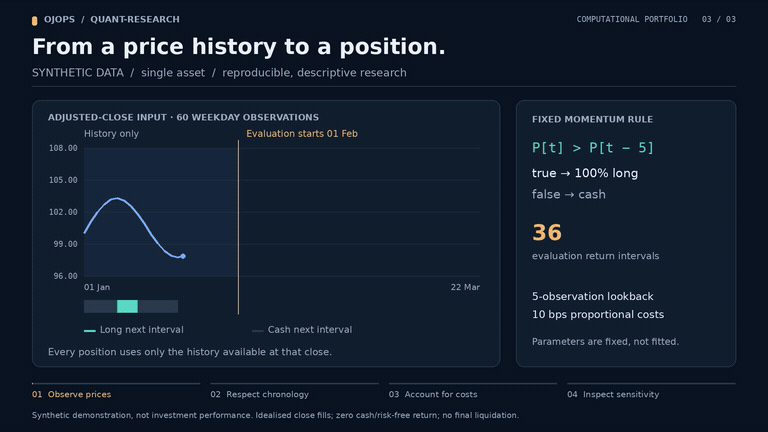

# Quantitative Research

A Python 3.10 project for reproducible single-asset return analysis and cost-aware backtesting. It provides a small, testable research foundation rather than a complete trading platform or a validated profitable strategy.

[](https://raw.githubusercontent.com/ojops/quant-research/04655a037b8421d7d7e9f633b05b149262a29da3/docs/media/demo.mp4)

**[Open or download the full MP4 — 38 seconds, 1080p](https://raw.githubusercontent.com/ojops/quant-research/04655a037b8421d7d7e9f633b05b149262a29da3/docs/media/demo.mp4).**
Follow signal timing, cost-aware compounding, and fixed parameter sensitivities
through the real CLI. Every result uses the bundled **synthetic** price series;
these are descriptive calculations, not evidence of investment performance.
[Recorded results](docs/media/demo-data.json) · [Regenerate the video](docs/DEMO.md).

The animation above plays the complete demonstration. Click it to open or download the 1080p MP4.

## Overview

The project loads an explicitly supplied price series, calculates returns and risk statistics, and compares a fixed momentum rule with buy-and-hold over a chronological evaluation period. It makes signal timing and transaction costs visible so that results can be inspected and reproduced.

## Features

- Validation of dated, adjusted closing prices from CSV
- Simple returns, compounded performance, volatility, Sharpe ratio and drawdown
- A fixed trailing-price momentum signal with no automatic parameter fitting
- Long-only, cash-or-asset backtests with proportional transaction costs
- Chronological holdout evaluation and buy-and-hold comparison
- JSON output including settings, input SHA-256, returns, positions, turnover and costs
- Synthetic example data and automated tests

The current implementation supports **one asset** and an idealised close-to-close execution model. It does not retrieve prices, optimise strategies, trade live or establish statistical significance.

## Requirements

- Python 3.10
- [uv](https://docs.astral.sh/uv/)

The instructions below assume Ubuntu or WSL running Ubuntu. Runtime calculations use the Python standard library.

## Installation

Clone the repository and install the locked dependencies:

```bash
git clone https://github.com/ojops/quant-research.git
cd quant-research
uv sync --locked
```

## Usage

Run the bundled synthetic example from the repository root:

```bash
uv run quant-research examples/synthetic_prices.csv --test-start 2024-02-01
```

Adjust the lookback and transaction-cost assumptions:

```bash
uv run quant-research examples/synthetic_prices.csv --test-start 2024-02-01 --lookback 5 --cost-bps 10
```

Alternatively, run the package as a module:

```bash
uv run python -m quant_research examples/synthetic_prices.csv --test-start 2024-02-01 --lookback 5 --cost-bps 10
```

Use `uv run quant-research --help` to see the available arguments.

### Input data

CSV input must contain these columns:

| Column | Meaning |
| --- | --- |
| `date` | Observation date in ISO `YYYY-MM-DD` format |
| `adjusted_close` | Finite, strictly positive adjusted closing price |

Dates must be strictly increasing and unique. The program does **not** download, reorder, forward-fill or adjust data. You are responsible for split/dividend adjustments and a consistent observation frequency.

The bundled `examples/synthetic_prices.csv` contains 60 weekday observations starting on 2024-01-01, generated from a deterministic mathematical price function. It tests functionality; it is **not real market data** or evidence of trading performance. No API keys or paid data services are needed.

### Output

The command prints JSON containing the input checksum, run configuration, evaluation dates, net returns and positions, turnover and costs, plus total and annualised return, sample volatility, zero-risk-free Sharpe ratio, and maximum drawdown. An undefined Sharpe ratio is represented as `null`.

## Research methodology

The example momentum rule targets a full long position when the latest price exceeds the price `lookback` observations earlier; otherwise it targets cash. A signal calculated at observation `t` affects only the **following** return interval, not the interval used to generate it.

The `--test-start` date must exist in the data and follow sufficient warm-up observations. The strategy and buy-and-hold comparison use the same evaluation horizon and both pay applicable initial entry costs. Earlier observations provide signal history; no parameters are trained automatically.

Transaction costs are based on actual value traded, including weight drift between observations. The model assumes fills at the observed signal close, which is an **idealised execution assumption**.

For formulas, turnover and fee accounting, see [research and accounting notes](docs/RESEARCH.md).

## Assumptions and limitations

- **Asset exposure:** A single asset, long-only weights between 0 and 1, cash with zero return, and no leverage or short selling.
- **Execution:** Close-based fills are idealised. Realistic next-session execution needs additional data and modelling.
- **Costs:** `--cost-bps` represents constant proportional fees/slippage, not market depth or an order book. No final liquidation is forced.
- **Sampling:** Annualisation uses the supplied observation frequency (252 per year by default). Missing sessions or irregular dates are not corrected automatically.
- **Statistics:** Sharpe assumes zero risk-free return and uses sample volatility. Serial dependence and short samples limit interpretation.
- **Research validity:** A chronological holdout does not eliminate selection bias, survivorship bias, data errors or multiple testing. Tuning after inspecting holdout results invalidates a claim of untouched out-of-sample performance.

## Development roadmap

- **Data provenance:** Record real-data sources, licences, adjustments, retrieval dates and immutable snapshots.
- **Experimental design:** Predeclare research questions, development periods and untouched holdouts.
- **Baselines:** Compare cash and buy-and-hold results across fixed periods and transaction-cost assumptions.
- **Statistical evaluation:** Estimate uncertainty and document all tested variations before making performance claims.
- **Extensions:** Consider plots, multiple assets and more realistic execution only after the baseline is reliable.

## Project structure

| Path | Purpose |
| --- | --- |
| `src/quant_research/data.py` | Input loading and price validation |
| `src/quant_research/analysis.py` | Return and risk calculations |
| `src/quant_research/backtest.py` | Trading signals and cost-aware backtesting |
| `src/quant_research/main.py` | Command-line interface and JSON output |
| `src/quant_research/__main__.py` | Supports `python -m quant_research` |
| `examples/synthetic_prices.csv` | Deterministic example input |
| `docs/RESEARCH.md` | Mathematics, assumptions and research guidance |
| `docs/STYLE.md` | Coding conventions |
| `tests/` | Automated behavioural and regression tests |
| `.github/workflows/checks.yml` | Automated checks |
| `pyproject.toml` / `uv.lock` | Project configuration and locked dependencies |

## Development

Run the automated checks:

```bash
uv run pytest
uv run ruff check .
uv run ruff format --check .
```

Run `uv run ruff format .` to apply formatting. When dependencies change, commit both `pyproject.toml` and `uv.lock`. See [coding conventions](docs/STYLE.md).

## License

MIT licensed. See [LICENSE](LICENSE).
