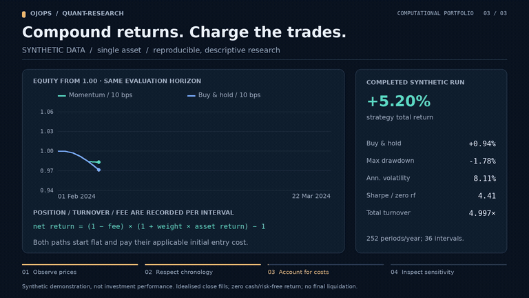

# Quantitative Research

A Python project for reproducible single-asset return analysis and cost-aware backtesting. This is a research baseline, **not** a validated profitable strategy or live trading system.

[](https://raw.githubusercontent.com/ojops/quant-research/04655a037b8421d7d7e9f633b05b149262a29da3/docs/media/demo.mp4)

*Preview: a backtest on synthetic prices. [Watch the full 38-second demonstration (MP4)](https://raw.githubusercontent.com/ojops/quant-research/04655a037b8421d7d7e9f633b05b149262a29da3/docs/media/demo.mp4) · [How the video is made](docs/DEMO.md).*

## Overview

This project provides an inspectable starting point for investigating trading rules: validate a price series, form a momentum signal, simulate a long-or-cash strategy with trading costs, and compare its results with buy-and-hold. Each run records settings and an input checksum to support reproducibility.

The bundled example uses **synthetic prices** to demonstrate the implementation, not to establish investment performance. Independent real-data evaluation and statistical validation are future development priorities.

## Features

- Validate dated adjusted-close prices from CSV
- Calculate returns, equity, volatility, Sharpe ratio and maximum drawdown
- Backtest a fixed momentum rule with long-or-cash positions
- Account for proportional trading costs, turnover and weight drift
- Compare with buy-and-hold over the same chronological evaluation period
- Export results, return paths, parameters and data checksums as JSON

The implementation covers **one asset** with idealised close-based execution. It does not download data, fit parameters or trade live.

## Requirements and Installation

Requires Python 3.10 and [uv](https://docs.astral.sh/uv/). These commands target Ubuntu or WSL. Core calculations use only the Python standard library.

```bash
git clone https://github.com/ojops/quant-research.git
cd quant-research
uv sync --locked
```

## Usage

The bundled prices are **synthetic** and are intended to test the implementation, not demonstrate investment performance.

```bash
uv run quant-research examples/synthetic_prices.csv --test-start 2024-02-01
uv run quant-research examples/synthetic_prices.csv --test-start 2024-02-01 --lookback 5 --cost-bps 10
```

CSV input requires strictly increasing, unique `date` values (`YYYY-MM-DD`) and positive finite `adjusted_close` values. The CLI does not download, adjust or fill missing prices.

Output JSON includes strategy and benchmark paths, performance metrics, settings and an input SHA-256 checksum. Run `uv run quant-research --help` for options.

## Research Method and Limitations

The signal compares the current price with its price `lookback` observations earlier. A signal calculated using the close at time `t` applies to the **following** return interval, not the interval that produced it.

The model charges proportional trading costs but assumes execution at the observed signal close, a zero-return cash position, a zero risk-free rate for Sharpe, and no forced final liquidation. A chronological evaluation period alone does not establish statistical significance. See [research and accounting notes](docs/RESEARCH.md).

## Development Roadmap

The priority is to progress from a reproducible synthetic backtest to defensible empirical research. Improving the experimental methodology takes precedence over adding visual effects.

### Planned

- **Use traceable real market data:** document sources, licences, price adjustments, missing observations, retrieval dates and checksums.
- **Predeclare a research hypothesis:** fix the instrument, signal, benchmark, transaction-cost assumptions and evaluation criteria before testing; separate development and tuning from an untouched holdout.
- **Run a reproducible out-of-sample experiment:** compare the strategy with buy-and-hold and cash over the same period, without treating synthetic demonstrations as evidence of profitability.
- **Assess uncertainty and execution realism:** test parameter and cost sensitivity, account for multiple comparisons and time-series dependence, and replace idealised same-close fills with an explicit executable timing model.
- **Generalise visualisations only when needed:** derive chart dates, axes and parameter labels from analysis outputs rather than the fixed synthetic example.

## Project Structure

```text
quant-research/
├── examples/
│   └── synthetic_prices.csv # Deterministic example price data
├── src/quant_research/
│   ├── data.py              # CSV loading and validation
│   ├── analysis.py          # Returns and risk statistics
│   ├── backtest.py          # Signals and cost-aware backtesting
│   └── main.py              # CLI and JSON reporting
├── scripts/                # Portfolio video rendering
├── tests/                  # Research and demonstration tests
├── docs/                   # Research and demo documentation
│   └── media/              # Preview GIF, MP4 and recorded data
├── pyproject.toml          # Project metadata and dependencies
├── uv.lock                 # Locked dependencies
└── README.md
```

## Development

```bash
uv run pytest
uv run ruff check .
uv run ruff format --check .
```

Dependencies are managed with `uv`; when changing them, commit both `pyproject.toml` and `uv.lock`. GitHub Actions runs automated checks. See [coding conventions](docs/STYLE.md). ## License

[MIT licensed](LICENSE).
